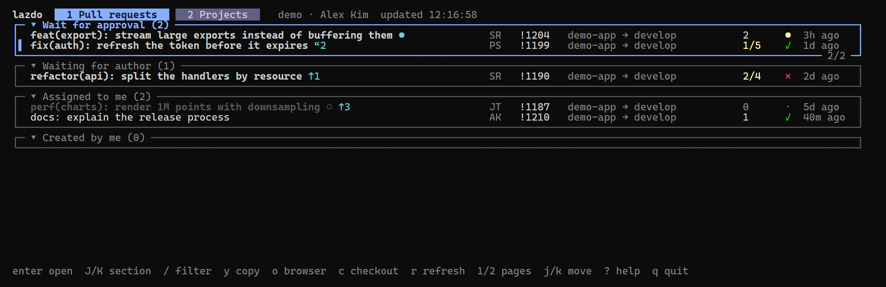
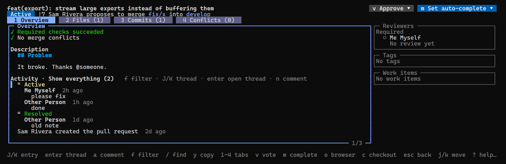
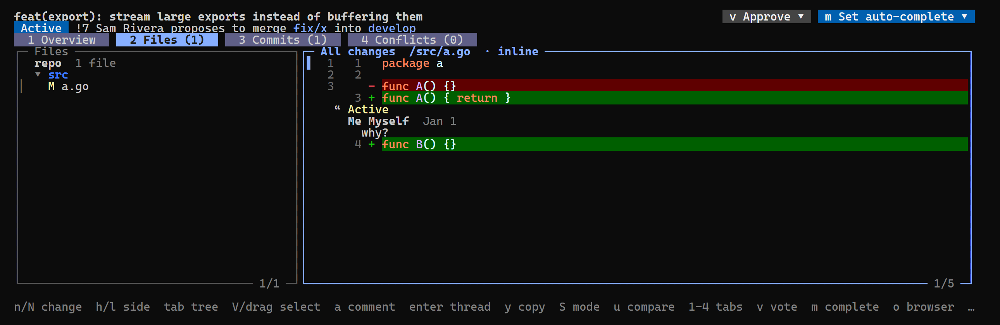
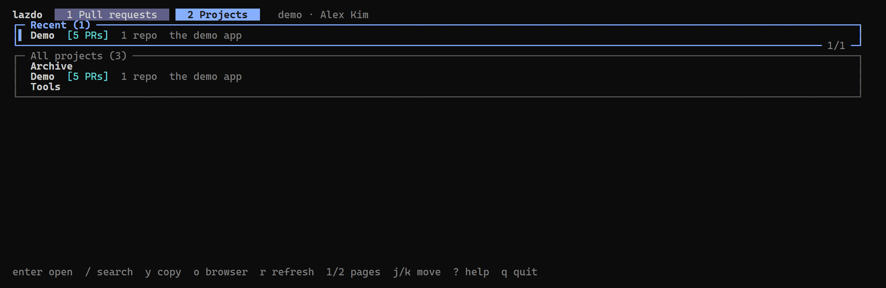
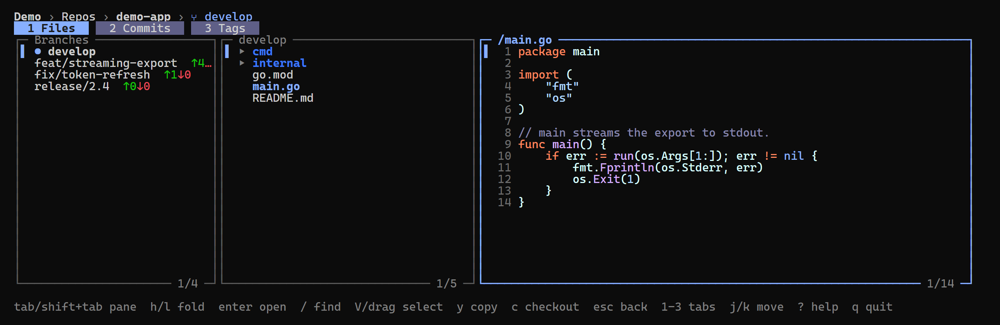
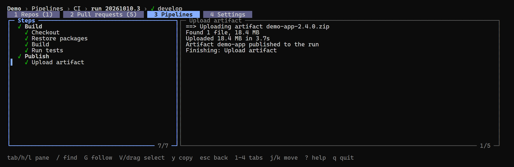
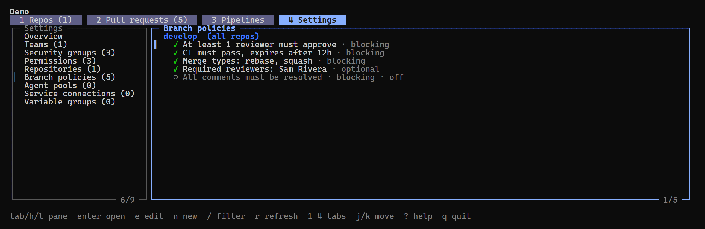

| `O` | switch organization or account |
# lazdo

A terminal UI for Azure DevOps, in the spirit of lazygit: review pull
requests, browse repos, follow pipelines and edit project settings without
leaving the keyboard.



- **Your pull requests** across every project of the organization, in the
  same Sections as Azure DevOps' "My pull requests" page, with what's new
  since your last visit.
- **Pull request review**: checks, description, activity and comment
  threads, a syntax-highlighted diff (side by side or inline, any two
  updates or a run of commits), voting, completing, commenting.
- **Projects**: every repo with its branches, files, commits and tags;
  pipelines with their runs and step logs; project settings such as branch
  policies, teams, groups and permissions, editable in place.
- **Fast on big files**, check out any branch in one key, copy anything
  with `y`, mouse support, and `?` for the keys wherever you are.

## Install

Linux and macOS (installs to `~/.local/bin`):

```sh
curl -fsSL https://lazdo.khanhtd36.dev/install.sh | sh
```

Windows PowerShell (installs to `%LOCALAPPDATA%\Programs\lazdo` and adds it
to your User PATH, saving the previous PATH to `%LOCALAPPDATA%\lazdo` first):

```powershell
irm https://lazdo.khanhtd36.dev/install.ps1 | iex
```

Homebrew (macOS and Linux):

```sh
brew install khanhtd36/tap/lazdo
```

With Go: `go install github.com/khanhtd36/lazdo@latest`. Binaries and
checksums: [releases](https://github.com/khanhtd36/lazdo/releases).

The scripts verify the download against the release's `checksums.txt`.

**Updating:** lazdo checks for a newer release at most once a day, in the
background, and shows `↑ v0.2.14 (U)` in the title when there is one. `U`
checks GitHub right away (at most every 2 minutes), then lists what
changed and installs it, even while lazdo runs. The title follows the
download (`updating v0.2.14 3.1/8.4 MB`), then says to restart; a slow
connection is fine, only 30 seconds without data stops it. A failed
update shows `update failed (U)`, and the next `U` shows why above the
newest release. `lazdo update` does the same from a shell. Copies installed with
Homebrew or `go install` show their own update command instead.

To pick a version or folder when installing:
`LAZDO_VERSION=0.1.0` / `LAZDO_INSTALL_DIR=<dir>` (sh), or
`$env:LAZDO_VERSION`, `$env:LAZDO_INSTALL_DIR`, and `$env:LAZDO_SKIP_PATH=1`
to leave PATH alone (PowerShell).

Uninstall:

```sh
rm ~/.local/bin/lazdo                                    # install.sh
brew uninstall lazdo                                     # Homebrew
Remove-Item -Recurse "$env:LOCALAPPDATA\Programs\lazdo"  # install.ps1, then drop it from your User PATH
```

## Auth

None of its own. lazdo borrows the token of the [Azure CLI](https://learn.microsoft.com/cli/azure/):

```sh
az login --allow-no-subscriptions
az devops configure -d organization=https://dev.azure.com/<org>   # optional, else pass --org
```

**Several orgs or accounts:** `O` (or a click on the org in the title)
lists every org of every account, last used first, and switches lazdo to
the one picked; lazdo opens on it next time too. An org no list has can
be typed in the filter. Accounts are az logins: az's own, plus any added
with "+ Add account…", which runs `az login` into a folder of lazdo's
(`AZURE_CONFIG_DIR`), so two accounts of one org never fight over az's
default. `d` removes an added account. With more than one account the
title shows which one by email.

## Usage

```sh
lazdo                    # last org used, else the default from `az devops configure`
lazdo --org contoso      # or a full https://dev.azure.com/<org> URL
lazdo --interval 30s     # auto-refresh period (default 2m)
lazdo --ascii            # markers as words, without checking the terminal
lazdo update             # install the newest release
lazdo --version
```

### Keys

The same keys mean the same thing in every view (outside text boxes); `?`
lists everything available where you are.

| Key | Everywhere |
| --- | --- |
| `j` / `k`, arrows | move down / up (or scroll a reading pane) |
| `ctrl+d` / `ctrl+u` | half page down / up |
| `g` / `G` | top / bottom |
| `enter` | one level deeper, or run |
| `esc` | back exactly one level (filter, thread, pane, view) |
| `q` | quit (`ctrl+c` quits even while typing) |
| `1`–`9`, `[` / `]` | pages or tabs at the current level |
| `tab` / `shift+tab` | next / previous pane in split views |
| `h` / `l` | left / right: pane, folder fold, or diff side |
| `J` / `K` | next / previous group (section, activity entry, push) |
| `/` | filter a list, or find text in a reading pane |
| `n` / `N` (or `p`) | next / previous match (in a diff: change; past the file's last or first change, pressing again opens the next or previous file) |
| `a` | add to the list you are looking at: a comment, branch policy, repository, team, group, variable, member or user (`A`: a variable group) |
| `y` | copy menu for the selection (URLs, names, paths, IDs) |
| `o` | open in the browser |
| `r` | refresh |
| `c` | check out the branch (asks where) |
| `U` | check for a newer lazdo and install it |

Questions show **Yes** and **No** buttons: `←` / `→` (or `tab`) pick one,
`enter` or a click presses it, and `y` / `n` answer directly. Yes starts
focused for what is easily undone (re-queue, change target, save
permissions, update); No does for anything else, such as abandon or delete.

### Pull requests page

Your pull requests, across every project of the organization, in four
Sections:

- **Wait for approval**: you're a reviewer, haven't voted, PR isn't a draft.
- **Waiting for author**: you voted "waiting for author" or "rejected". `↑N` flags pushes since your last visit.
- **Assigned to me**: every other PR you review (drafts, ones you approved).
- **Created by me**.

Each Section is a pane; one scroll moves through all of them, and `J` / `K`
jump between them. Each row: title, markers, author, ID, repo → target
branch, resolved/total comment threads, checks: build policies and required
external ones (`✓` `×` `●` running), last update. Reviewer votes are in the
PR detail.

The title is bold when there is something new: pushes or comments since
your last visit, or a PR ready for review you haven't opened. The markers:

| Symbol | Words | Meaning |
| --- | --- | --- |
| `↑3` `“2` `★1` | `[+3 pushes]` `[+2 comments]` `[+1 vote]` | new since your last visit |
| `●` | `[new]` | not opened yet |
| `◌` | `[draft]` | draft |

Symbols are used when the terminal draws them one column wide, checked at
start-up (East Asian width settings draw them two wide); otherwise words,
shortened to `[+3p]` and `[d]` on narrow screens. `--symbols` / `--ascii`
or `LAZDO_SYMBOLS=1` / `0` decide instead.

`enter` opens a PR or collapses a Section, `/` filters by title, author, ID
or branch (each Section's title then counts its matches, `(4 → 1)`). A
number (`1204` or `!1204`) matches PR IDs as typed, not fuzzily; the same
goes for a project's pull requests.

### PR detail

Opening a PR counts as a visit, exactly like opening it in the browser: its
"new since last visit" counts reset, and the activity filter "What's new"
shows what arrived since your previous visit.

Tabs: **Overview** (checks, description, activity, reviewers, tags, work
items), **Files** (file tree and syntax-highlighted diff), **Commits**
(grouped by push; `enter` diffs one commit), **Conflicts**.





Checks include external ones, statuses a CI outside Azure DevOps posts
(GitHub Actions, say): each shows its latest description and state, like
the web's Checks panel. On Overview, `o` and `y` offer each check's run
next to the pull request.

**Pipeline runs** open right in the pull request: `b` lists its build
policies' latest runs, then any other pipeline run on it, and `enter` shows
one with its steps and log (the only one opens straight away; clicking a
build check opens its run too). `esc` comes back to the Overview. `Q`
re-queues a build policy, after asking; from a run, lazdo switches to the
new run once it starts. A policy still running isn't re-queued.

Files can show a run of commits instead of the whole PR: `enter` on a
commit, or `u` → Commits… to mark them (`space`; `a` all or none). The
marked commits and everything between them make one diff, since commits
with gaps between them have none; picking every commit is All changes. The
Files tab then reads `(3 of 12 commits)`, the Commits tab marks them `●`,
and a run holding a merge commit warns that target-branch changes show.
`u` → All changes goes back.

Keys specific to a pull request (on top of the ones above):

| Key | Action |
| --- | --- |
| `v` | vote: approve, approve with suggestions, wait for author, reject, reset |
| `m` | complete, set/cancel auto-complete, mark as draft/publish, change target branch, abandon (click the target branch in the subtitle to change it) |
| `E` | edit the title and description (`ctrl+e` in `$EDITOR`: title, blank line, description) |
| `a` | add a comment (Overview: on the PR · diff: on the line or `V` range) |
| `R` / `s` / `e` / `d` | reply / status / edit / delete on the selected thread |
| `f` | Overview: choose the activity filter (each with its count) |
| `b` | Overview: pipeline runs of the pull request |
| `Q` | Overview or a run: re-queue a build policy |
| `S` | Files: side-by-side ⇄ inline (default follows terminal width) |
| `u` | Files: compare all changes, since my last visit, one update, any two, or commits |
| `V` | diff: start or clear a line range |
| `z` | Files: hide / show the file tree |

`enter` steps into a comment thread (then `j`/`k` picks a comment). Comments
are typed in a text box: `ctrl+s` posts, `ctrl+e` continues the draft in
`$EDITOR`, `esc` asks before discarding a changed draft.

### Projects page

`2` (or `[` / `]`) switches to the Projects page: your recent projects,
then other projects with open pull requests, then all projects A–Z. `/`
searches projects **and every repo in the organization**; `enter` on a
found repo opens its browser.



Inside a project:

- **Repos**: default branch, last push, size. `enter` opens the repo
  browser: branches (ahead/behind the default branch) │ file tree │ file
  content. Folders load as you open them; `/` in the tree finds any file in
  the repo (the full list loads in the background the first time). Files
  are syntax highlighted, markdown is rendered (`M` for raw), `/` finds
  text in the file. Switching branch keeps your open folders and file. `z`
  folds the branches away (automatic on narrow screens).

  

  The repo view has tabs **1 Files · 2 Commits · 3 Tags**:
  - **Commits**: the selected branch's history (branch pane on the left),
    with tag badges and change counts; more load as you scroll. `enter`
    shows the commit's diff, `T` tags it (empty message: lightweight tag),
    `c` checks it out detached.
  - **Tags**: newest version first, with the selected annotated tag's
    tagger, date and message. `enter` shows the release changes (commits
    since the previous version tag), `D` one diff of everything since it,
    `d` deletes the tag.
  - `d` in the branch pane deletes a branch (never the default; a PR using
    it is named in the question).
- **Pull requests**: everyone's active PRs; `enter` opens the PR detail.
- **Pipelines**: latest run of each; `enter` lists runs, `enter` on a run
  shows its stages, jobs and steps beside the selected step's log (`/` finds
  text in it). A running run refreshes every few seconds; a step's log
  appears once the step ends (Azure DevOps only streams live logs to the
  browser).

  

- **Settings**: the project's settings, section by section (Overview,
  teams, security groups, permissions, repositories, branch policies,
  agent pools, service connections, variable groups). Branch policies are
  grouped by branch, each written as the rule it enforces; `enter` on a
  team or group lists its members, and in Permissions shows the group's
  project-level permissions. Editable so far: branch policies,
  repositories, variable groups, teams and security groups. `e` edits,
  `a` adds, `d` deletes (a repository or group only after its name is
  typed; repositories go to the recycle bin), `space` turns a policy on or
  off, `A` adds a variable group (`a` a variable to the selected one),
  and in a member list `a` adds people or groups by name or email and `d`
  removes one. Forms list what will change
  before `ctrl+s` saves. A secret's value is never shown; left empty, the
  stored secret is kept. In a group's permissions, `space` cycles one
  through not set, allow and deny; changes wait until `ctrl+s`, which
  lists them and asks first, and each is saved on its own. On a service
  connection, `space` grants or withdraws access for all pipelines and `d`
  deletes it (after its name is typed); credentials are never shown.

  Permissions lists the groups, then the users: everyone in the project's
  groups, directly or through a group nested in them (`via Developers`),
  with the groups they're in. `a` adds people to a group (Contributors
  unless you pick another); `d` on a user removes them from every project
  group they're in, saying when a group from outside the project still
  lets them in. `enter` on a user lists their groups, where `a` adds them
  to another and `d` removes them from one.

  

**Checkout** (`c`, wherever a branch is shown) asks for a folder: the working
directory if it is a clone of the repo, the last folder you used, or a new
`./<repo>` folder. An existing clone is fetched and switched, a missing or
empty folder gets a fresh clone; nothing is ever forced.

### Help

`?` lists the shortcuts for where you are, most specific first. `/` filters
them fuzzily; `enter` runs the selected one.

### Copying text

In the file content, diff and pipeline log, `V` (or dragging the mouse)
selects whole lines and `y` copies them: the original text, without line
numbers, colors or wrap breaks (logs without their timestamps). With
nothing selected, `y` opens the Copy menu (current line, whole log, file
path, URLs, commit IDs, …); on a tag it copies the tag name. Inside a comment thread, `y` copies the
comment's markdown. Shift+drag still uses the terminal's own selection.

### Mouse

Click selects; clicking what is already selected opens it (a PR, a comment
thread, a commit, a file's diff). Click section headers to collapse them,
tabs to switch, and the vote / complete buttons and menu items to act; a
click outside a menu closes it. In the diff, a click picks the line and the
side. The wheel scrolls whatever is under the pointer.

lazdo captures the mouse, so select text with shift+drag.

## Development

`go test ./...` runs the tests. Push a `v*` tag and goreleaser publishes
the binaries.

The screenshots come from made-up data: `scripts/shots.sh` renders each
screen and photographs it with a headless Edge or Chrome (Cascadia Mono
font needed) into `docs/screenshots`.

## License

MIT
